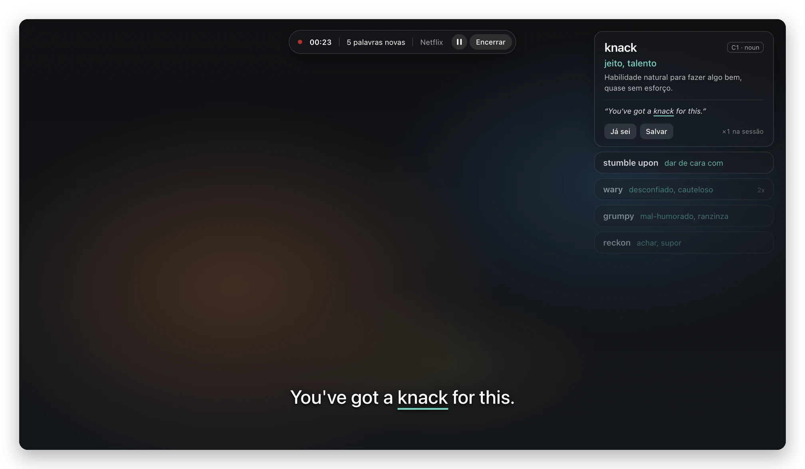
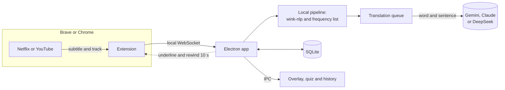
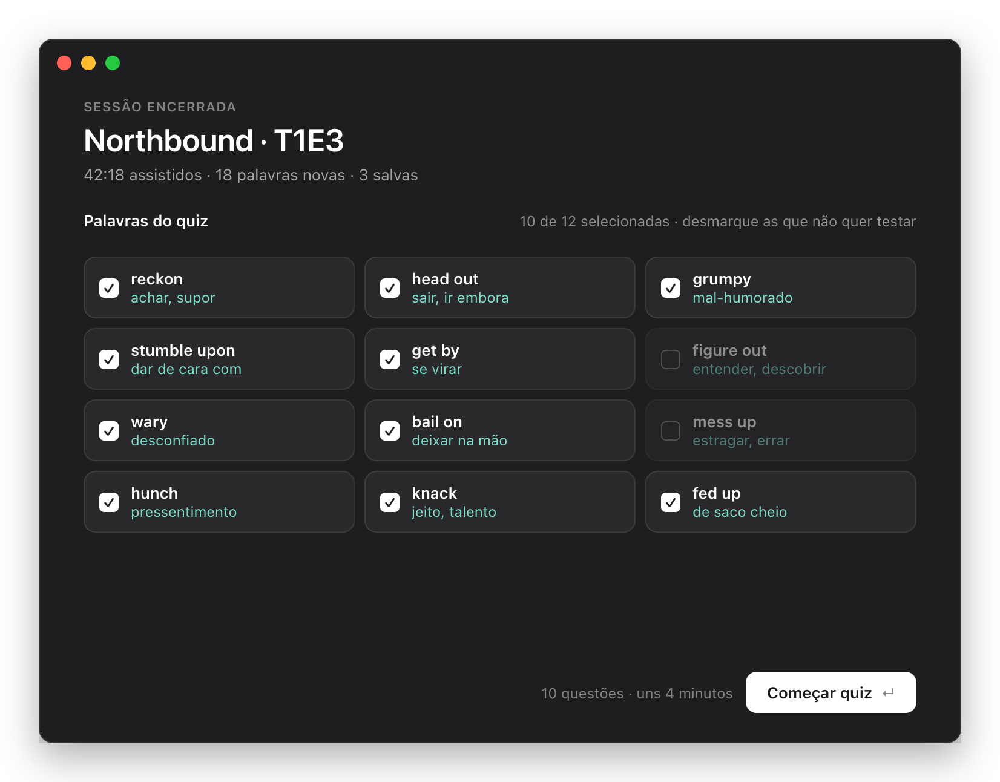
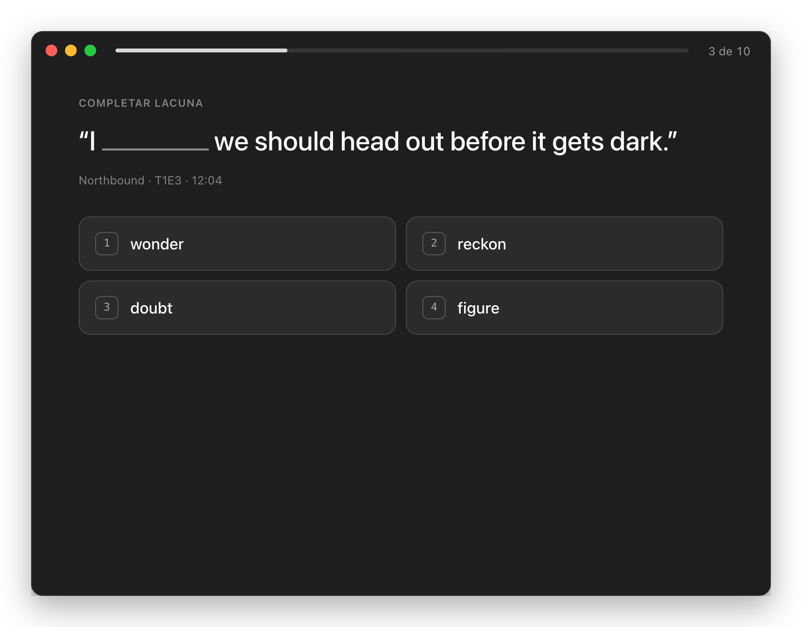
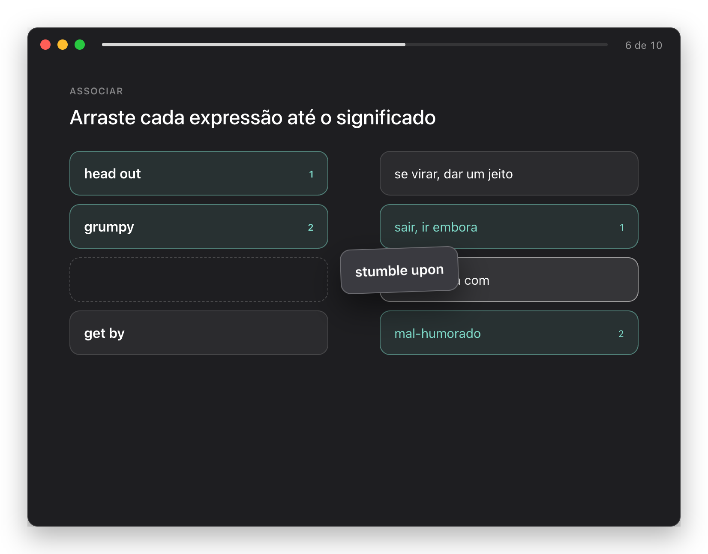
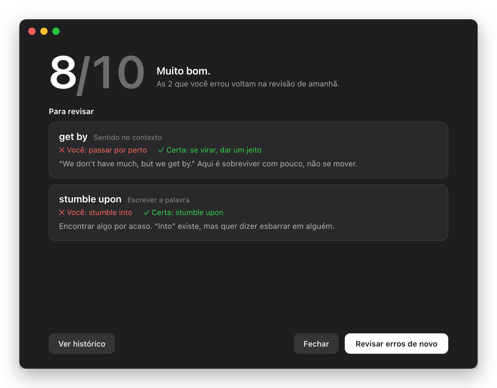
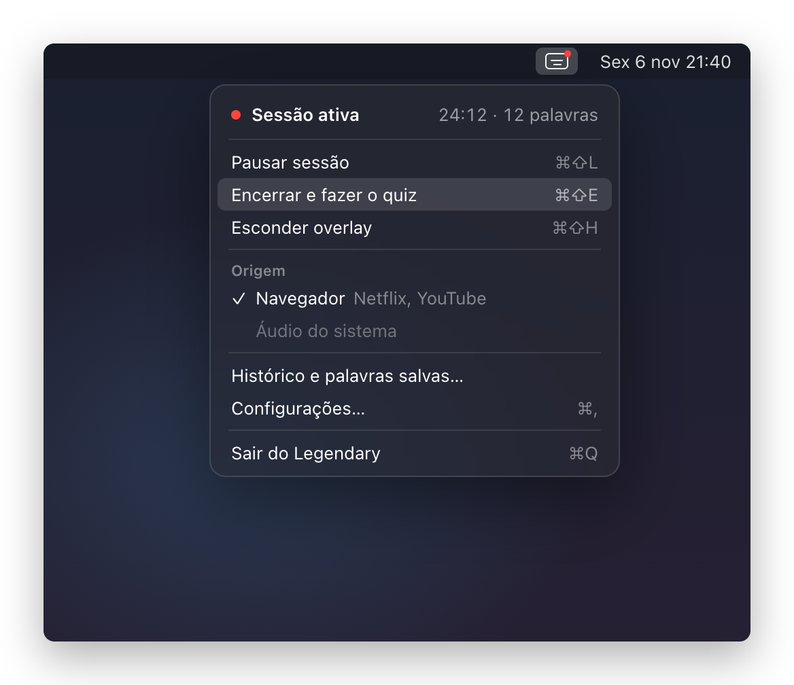
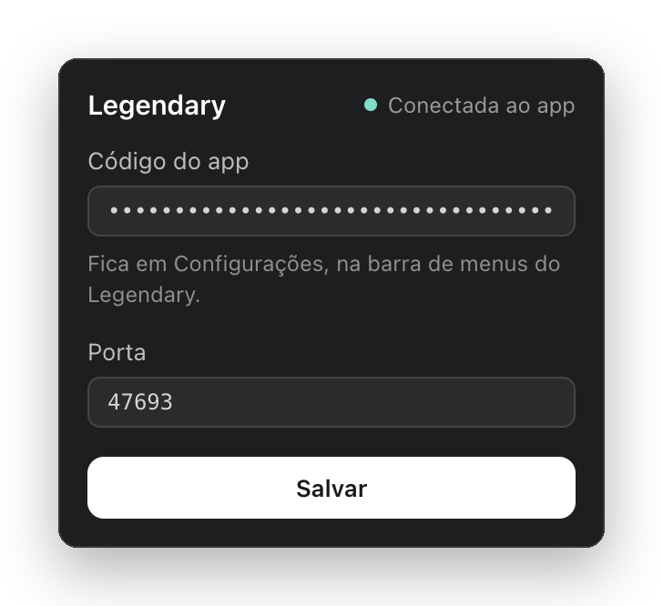

# Legendary: immersion without pausing

Watching with English audio and English subtitles is one of the most common tips teachers give to
anyone who wants to become fluent. The problem is the word you don't know: pausing the video to look
it up breaks the immersion, and letting it go means losing exactly the new vocabulary.

Legendary takes that pause out of the way. It reads the Netflix or YouTube subtitles while you watch
and, when a word at your level shows up, the translation appears in the corner of the screen, already
in the sense used in the scene, without you touching anything. The video keeps going, and at the end
of the session a quiz reviews the words that came up.

It is a macOS app with an extension for Brave or Chrome. Everything stays on your Mac, with no
account and no server. The interface is in Brazilian Portuguese, because the app is made for
Brazilian learners.

<p align="center">
  
</p>

> The screenshots come from the real app, with sample translations and an illustrative scene in
> place of the video. The quiz, the history and the menu bar come from the preview page, which mounts
> the same components with the data from the mockup.

## How it works

1. You turn on English subtitles on Netflix or YouTube and start a session with ⌘⇧L.
2. The extension reads each subtitle as it appears and sends it to the app over a local WebSocket.
   On YouTube it also sends the whole subtitle track of the video, which the player has already
   downloaded.
3. The app picks the words at your level, asks the AI for the translation and shows a card in the
   corner of the screen. The word is also underlined in the subtitle itself.
4. When you end the session with ⌘⇧E, you choose the words and take a quiz. The ones you get wrong
   come back for review in the following days.



Each subtitle goes through cleanup, tokenization and lemmatization, detection of phrasal verbs and
expressions, and a filter for your level based on a frequency list grouped by lemma. All of this runs
on the Mac. Only the chosen words go to the AI, together with the sentence where they appeared, so
the translation follows the sense of the scene.

A translated word is saved and does not go back to the AI for a new translation. When the AI says
the word has other common senses, like _bank_ or _pitch_, the saved card shows up right away and a
short call checks whether that sense fits the new scene. If none of the saved senses fits, the AI
writes a new one.

## What makes the cards smart

- **Your level adapts to you.** The level you choose in Settings is only the starting point. Words
  you mark as known move the cut up, and words you look up, save or get wrong in the quiz move it
  down. Legendary looks for the point in the frequency list that best separates the two groups.
- **Your history decides which words become cards.** A word you got right three times in a row no
  longer becomes a card. A word whose review is due goes ahead of the others, because seeing it in a
  real scene is the best review. Among words with the same score, the one already translated comes
  first.
- **On YouTube, the whole episode counts.** With the full track in hand, the app ranks each word by
  how often it appears in the whole video, not only so far, and translates the best ones in advance,
  in the order they show up. It only uses the track after a subtitle on the screen confirms that it
  belongs to the video being watched.
- **The cards follow the browser.** With more than one monitor, the cards appear on the screen where
  the browser window is.

## Features

### Cards over the video

- A new card shows the translation, a short explanation in Portuguese and the sentence from the
  scene. Earlier cards shrink to a summary, and hovering over one opens it again, with another
  example.
- The translation streams in, before the explanation, and the next words are translated while you
  read the current card.
- It works with the video in full screen, and the stack can be dragged anywhere on the screen. Each
  monitor keeps its own position.
- Buttons to save the word or mark it as known, so it no longer shows up.

<table>
  <tr>
    <td width="50%"></td>
    <td width="50%"></td>
  </tr>
  <tr>
    <td>In a bright scene. The session bar almost disappears while the mouse is away from the top.</td>
    <td>The states of the bar and the cards: paused, missing subtitles, AI error, translation on the way and the card opened by the mouse.</td>
  </tr>
</table>

### Search with ⌘⇧B

Heard a word that did not become a card? ⌘⇧B opens a bar over the video, even in full screen,
without taking the browser out of focus. The word comes in as a regular card, with the subtitle
sentence where it appeared, and goes to the history and the quiz. An option rewinds the video
10 seconds so you can hear it again.

<p align="center">
  
</p>

### All words and more than one card at a time

The level chooses the words by frequency, and sometimes lets through one you did not know. The "All
words" mode ignores the level. A word that comes back appears only as a summary, with a `2x`, `3x`
counter, without calling the AI again, and hovering shows the rest.

In Settings you also choose how long each card stays open, from 3 to 30 seconds, how many stay open
at the same time, up to 3, how many cards per minute and how many summaries stay on the screen.

<table>
  <tr>
    <td width="40%"></td>
    <td width="60%"></td>
  </tr>
</table>

### Quiz and review

When the session ends, you see what you learned, choose the words and take the quiz: 10 questions
by default, from 5 to 20 in Settings. There are 7 question types: multiple choice in both
directions, fill in the sentence, sense in context, matching, true or false, and typing the word.
Keys 1 to 4 answer and Enter moves on.

- The first question appears as soon as the AI writes it, and the others arrive while you answer.
  If the AI stops early, fails or there is no key or internet, the quiz is completed locally.
- About a third of the questions are kept for words whose review is due, the most overdue first,
  even after a long session.
- The words go into spaced repetition with SM-2. The grade of each answer depends on the effort: a
  word typed from memory counts more than a true or false.

<table>
  <tr>
    <td width="50%"></td>
    <td width="50%"></td>
  </tr>
  <tr>
    <td width="50%"></td>
    <td width="50%"></td>
  </tr>
</table>

### History

Every session and word, with how many times each one appeared, the right answers, the level and the
next review. You can search, filter and retake the quiz of a session.

<p align="center">
  
</p>

### Menu bar and extension

<table>
  <tr>
    <td width="62%"></td>
    <td width="38%"></td>
  </tr>
  <tr>
    <td>The menu bar menu controls the session, hides the overlay or only the session bar, and opens the history and Settings.</td>
    <td>The extension popup, where you paste the code that connects the browser to the app.</td>
  </tr>
</table>

## Shortcuts

| Shortcut | What it does |
| --- | --- |
| ⌘⇧L | Starts the session, or pauses and resumes it |
| ⌘⇧E | Ends the session and opens the quiz |
| ⌘⇧B | Opens the word search. Also works with the focus on the player |
| ⌘⇧K | Marks the word of the current card as known |
| ⌘⇧H | Hides or shows the cards |

## Technologies

| Layer | Technology |
| --- | --- |
| Language | TypeScript 6 in `strict` mode, in a pnpm 12 monorepo |
| Desktop | Electron 45 and electron-vite 6 |
| Interface | React 19, Tailwind CSS 4, Motion 14 and Zustand 5 |
| Database | SQLite with better-sqlite3 13 and Drizzle ORM 0.45 |
| AI | AI SDK 7 with Gemini (`gemini-2.5-flash`), Claude (Haiku 5.5 translates and Opus 5.5 builds the quiz) and DeepSeek (`deepseek-v4-flash`) |
| Natural language | wink-nlp 2, local: tokenization, lemmatization and parts of speech |
| Contracts | Zod 4 for IPC messages, the WebSocket and AI responses |
| Extension | WXT 0.21, Manifest V3 |
| Communication | Local WebSocket with `ws` 8 |
| Tests | Vitest 5 and Playwright 1.65 for the Electron app, the extension and the comparison with the mockup |
| Quality | ESLint 10, Prettier 3, Lefthook and commitlint |
| Packaging | electron-builder 26 |

## Structure

```
apps/
  desktop/     Electron app: main process (services, AI, database and windows), preload and screens
  extension/   Extension: reads the subtitles and the YouTube track, underlines words, rewinds
packages/
  contracts/   Shared schemas and types: IPC, WebSocket, AI and domain
  core/        Pure logic: subtitle pipeline, personal level, quiz and spaced repetition
  db/          Database schema and migrations
design/        Copy of the mockup and the reference frames of the visual tests
docs/          Screenshots
```

## Privacy and security

- Sessions, words and quizzes live in a SQLite database in `~/Library/Application Support/Legendary`.
  There is no Legendary account or server.
- Only the chosen words and the sentence where they appeared go to the AI, straight to the provider
  you chose, with your key. To check the sense of a saved word, the call also carries the
  translations already saved for it.
- On YouTube, the extension reads the subtitle track the player has already downloaded, in English
  only, and sends it only to the app on your Mac.
- The API key is encrypted with Electron's `safeStorage`, which keeps the encryption key in the
  Keychain. It never leaves the main process: the windows only receive a masked version.
- The WebSocket only listens on `127.0.0.1`, requires the pairing code and refuses connections coming
  from websites.
- The windows run sandboxed with context isolation, without access to Node and with a strict CSP.
  Every IPC message is validated.

## Running it

Requirements: macOS 13 or newer, Homebrew, Xcode Command Line Tools, Brave or Chrome, and an API key
for Gemini, Claude or DeepSeek.

```bash
brew install node@22 pnpm
make setup
make dev
```

The `Makefile` uses Homebrew's Node 22 even when it is not the machine's default. On the first run,
the app asks for the API key and your English level.

To install the extension:

1. Run `make build-ext`, which generates the `apps/extension/.output/chrome-mv3` folder.
2. In `brave://extensions` or `chrome://extensions`, turn on developer mode, click "Load unpacked" and
   choose that folder. Since `.output` starts with a dot, press ⌘⇧. in the file picker to see hidden
   folders.
3. Copy the code in Settings → Extension and paste it in the extension popup.

After updating the extension code, reload it on the extensions page.

## Commands

| Command | What it does |
| --- | --- |
| `make dev` | Runs the app with hot reload |
| `make build-ext` | Generates the extension in `apps/extension/.output/chrome-mv3` |
| `make ci` | Lint, types, and unit and integration tests |
| `make test-e2e` | End-to-end tests on the real app, including the extension in Chromium |
| `make test-visual` | Compares each screen with its frame from the mockup, in `design/reference` |
| `make db-generate` | Generates a migration from the Drizzle schema |
| `make package` | Builds the local `.dmg`, unsigned |
| `make help` | Lists every target |

The end-to-end tests open real windows and register the global shortcuts while they run, so it is
better not to use the computer at the same time.

To rebuild the frequency list from the FrequencyWords file, run
`node apps/desktop/scripts/build-lexicon.mjs path/to/en_50k.txt` with Node 22.18 or newer. The script
reduces each word to its lemma with the same tokenizer the app uses and adds up the counts.

## UI

The visual reference is the Claude Design mockup, with a local copy in `design/`. Every UI change
must be checked against it. The screens are components without IPC access, and the
`src/renderer/preview` page mounts them with the mockup data for `make test-visual` to compare.

## Third-party data

The frequency list derives from the FrequencyWords project, under CC BY-SA 4.0, grouped by lemma.
See `apps/desktop/resources/NOTICE.md`.
