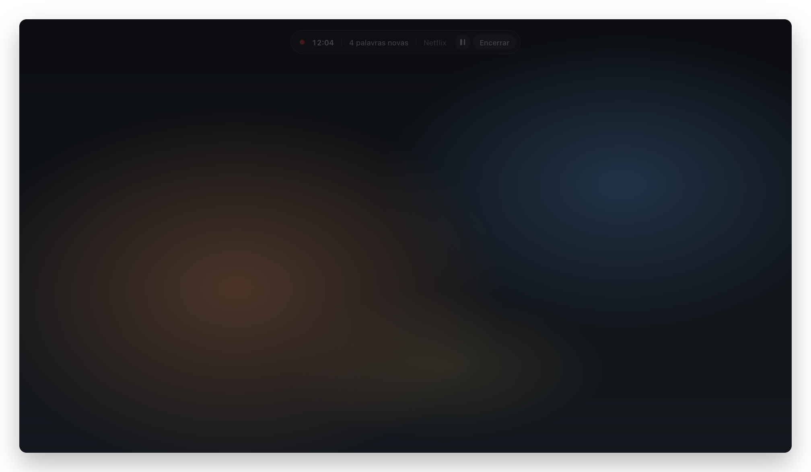
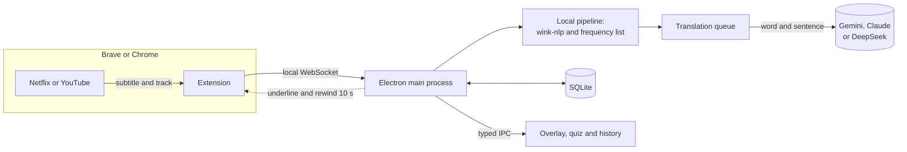
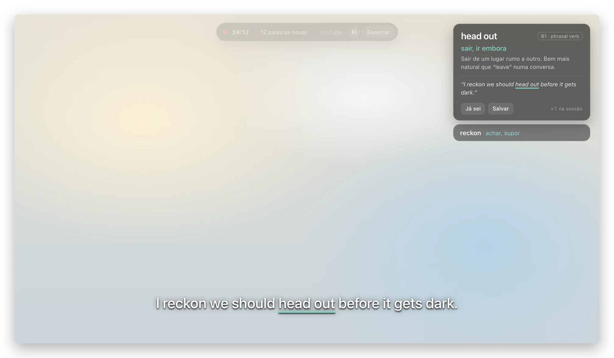
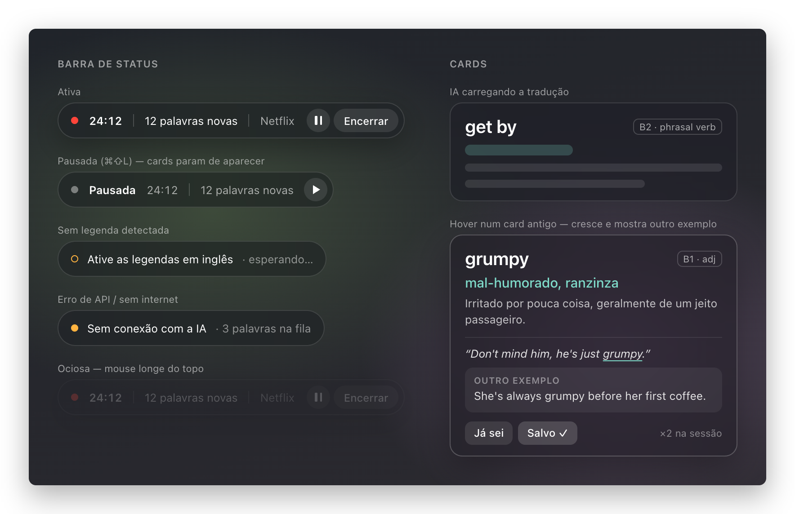
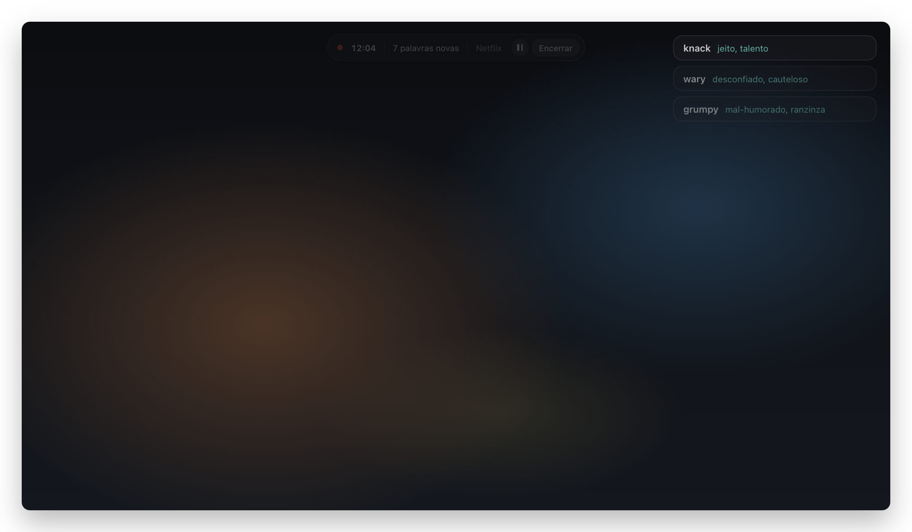
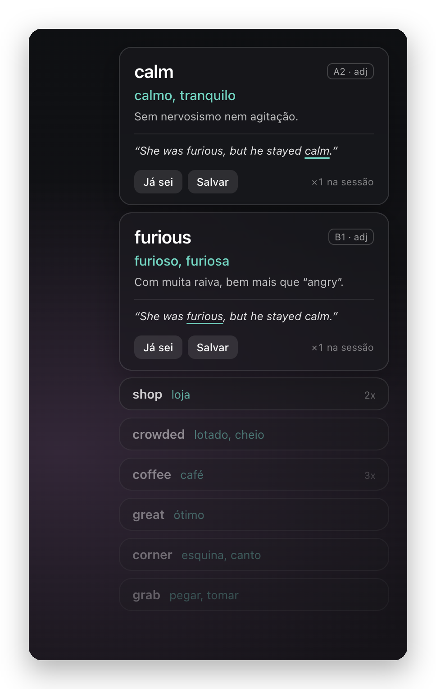
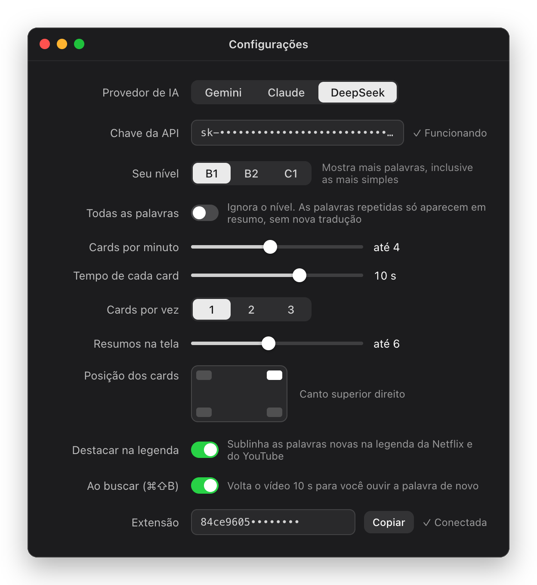
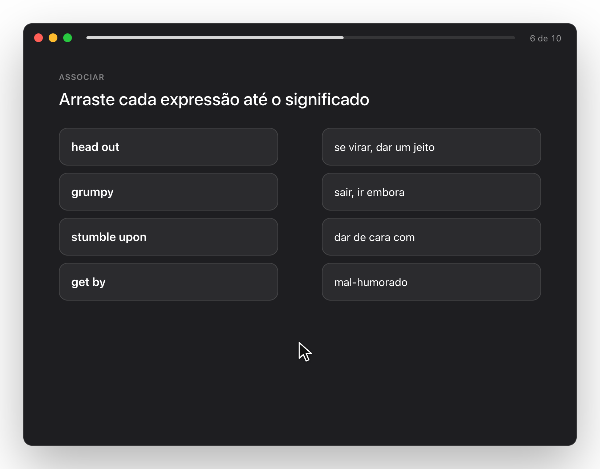
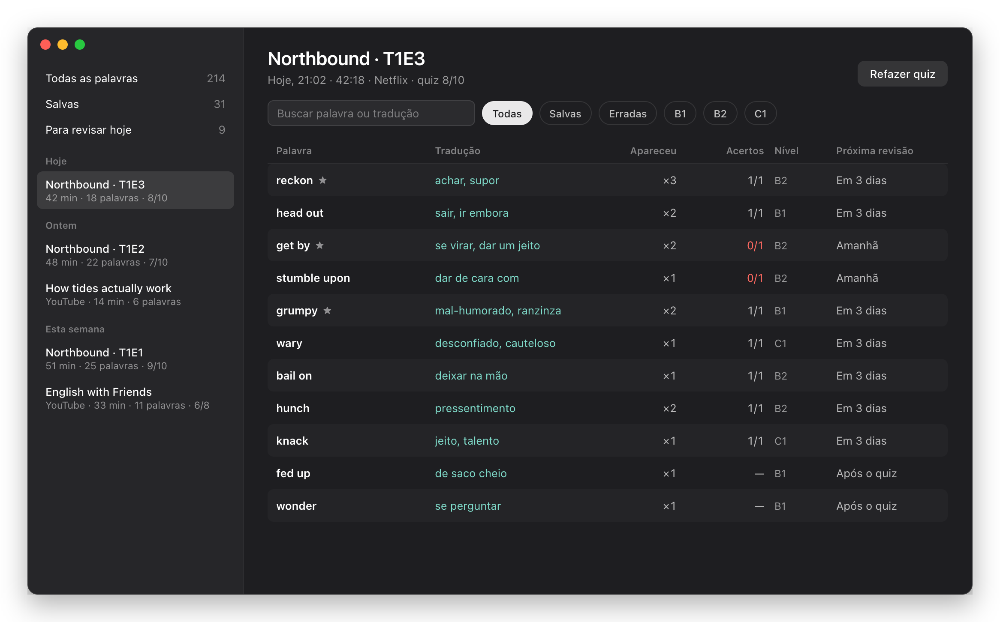

<div align="center">

# Legendary

**Learn English from the shows you already watch, without pausing the video.**

A macOS app and browser extension that reads Netflix and YouTube subtitles in real time and shows
the words at your level over the video, translated in the sense of the scene.

[](#getting-started)
[](#tech-stack)
[](#tech-stack)
[](#tech-stack)
[](#security-and-privacy)

[How it works](#how-it-works) · [Engineering](#engineering) · [Features](#features) · [Getting started](#getting-started)

</div>

<p align="center">
  
</p>

## Why

As a Brazilian learning English, I followed the tip every teacher gives: watch with English audio
and English subtitles. What always bothered me was the word I didn't know. Pausing the video to look
it up broke the immersion, and letting it go meant losing exactly the vocabulary I was there to
learn.

I built Legendary to remove that pause. When a word at your level shows up, its translation appears
in the corner of the screen, in the sense used in the scene, without you touching anything. The
video keeps playing, and at the end of the session a quiz reviews the words that came up.

Everything stays on your Mac, with no account and no server. The interface is in Brazilian
Portuguese, because I made it for Brazilian learners like me.

## Highlights

- **Translation in context.** Only the chosen word and its sentence go to the AI, so each card
  carries the sense used in the scene. A word with several senses, like _bank_ or _pitch_, is checked
  against every new scene.
- **A level that learns.** The level you pick is only the starting point. Words you mark as known,
  look up, save or miss in the quiz keep moving the cut on a frequency list.
- **Real time.** The translation streams in before the explanation, the next words are translated
  while you read, and on YouTube the whole episode is ranked and translated ahead.
- **Spaced repetition built in.** A quiz with seven question types closes each session and feeds
  SM-2, graded by how much effort each answer took.
- **Private by design.** Local SQLite, the API key encrypted in the Keychain, and a WebSocket bound
  to localhost behind a pairing code.
- **Tested like a product.** Nearly 600 unit and integration tests, end-to-end tests that drive the
  real Electron app and the extension, and visual regression of every screen against its design
  frame.

## How it works

1. You turn on English subtitles on Netflix or YouTube and start a session with ⌘⇧L.
2. The extension reads each subtitle as it appears and sends it to the app over a local WebSocket.
   On YouTube it also sends the whole subtitle track, which the player has already downloaded.
3. The app picks the words at your level, asks the AI for the translation and shows a card in the
   corner of the screen. The word is also underlined in the subtitle itself.
4. When you end the session with ⌘⇧E, you choose the words and take a quiz. The ones you miss come
   back for review in the following days.



## Engineering

### Architecture

- A pnpm monorepo with two apps, `apps/desktop` (Electron) and `apps/extension` (WXT, Manifest V3),
  and three shared packages.
- Only the Electron main process touches the database, the network and the API key. Every window is
  a sandboxed React renderer that talks to it through a typed IPC bridge.
- `packages/contracts` holds Zod schemas for every IPC message, the WebSocket protocol and the AI
  responses, so the same types are validated at each boundary.
- `packages/core` is plain TypeScript with no Electron dependency: the subtitle pipeline, the
  personal level, quiz grading and SM-2.

### Subtitle pipeline

Each subtitle goes through cleanup, tokenization, lemmatization and part-of-speech tagging with
wink-nlp, detection of phrasal verbs and expressions, and a filter against a frequency list grouped
by lemma. All of it runs on the Mac. Only the chosen words leave it, together with their sentence.

### AI layer

- One interface for Gemini, Claude and DeepSeek through the AI SDK, with structured output validated
  by Zod.
- A queue batches up to 5 words per call, allows at most 10 calls a minute and 3 at once, serves the
  words on screen before the ones translated ahead, and backs off from 2 s to 60 s when the provider
  fails.
- Translations are stored by sense. A word with other common senses shows its saved card at once,
  while a short call to the fast model keeps that sense, switches to another saved one or asks for a
  new one.
- The quiz streams: the first question appears as soon as the model writes it. If the model stops
  early, fails, or there is no key or connection, the rest of the quiz is built locally.

### Learning model

- **Personal level.** The level from Settings is a prior. The frequency cut is the rank that
  misclassifies the fewest of your known and unknown words, weighed against drifting far from that
  prior, so one stray word does not move it.
- **Choosing cards.** Words are scored by frequency and, on YouTube, by how often they appear in the
  whole episode. A word due for review gets twice its score, and one answered right three times in a
  row stops becoming a card.
- **Review.** SM-2, with grades by effort: 5 for a typed word, 4 for a chosen one, 3 for true or
  false, 1 for a miss. About a third of each quiz goes to the most overdue reviews.

### Testing

| Layer | What runs | Size |
| --- | --- | --- |
| Unit and integration | Vitest, including the main-process services over a real SQLite database with a fake AI provider | ~590 tests |
| End-to-end | Playwright drives the built Electron app through the WebSocket, and loads the real extension in Chromium against Netflix and YouTube fixtures | 15 tests |
| Visual | Each screen, mounted with the mockup data, compared with its frame from the design | 15 frames |

CI runs lint, type checking and the unit and integration tests on every pull request. Commits follow
Conventional Commits, enforced by commitlint and Lefthook.

### Security and privacy

- Sessions, words and quizzes live in a SQLite database in `~/Library/Application Support/Legendary`.
  There is no Legendary account or server.
- Only the chosen words and their sentence go to the AI, straight to the provider you chose, with
  your key. To check the sense of a saved word, the call also carries the senses already saved.
- On YouTube, the extension reads the English subtitle track the player has already downloaded and
  sends it only to the app on your Mac.
- The API key is encrypted with Electron's `safeStorage`, which keeps the encryption key in the
  Keychain. It never leaves the main process: the windows only get a masked version.
- The WebSocket listens only on `127.0.0.1`, requires the pairing code and refuses connections from
  websites.
- The windows run sandboxed with context isolation, no access to Node and a strict CSP. Every IPC
  message is validated.

## Features

### Cards over the video

- A new card shows the translation, a short explanation in Portuguese and the sentence from the
  scene. Earlier cards shrink to a summary, and hovering opens one again, with another example.
- It works with the video in full screen, and the stack can be dragged anywhere. Each monitor keeps
  its own position, and the cards follow the monitor where the browser is.
- Buttons save the word or mark it as known, so it stops showing up.

<table>
  <tr>
    <td width="50%"></td>
    <td width="50%"></td>
  </tr>
  <tr>
    <td>In a bright scene, the session bar almost disappears while the mouse is away from the top.</td>
    <td>The states of the bar and the cards: paused, missing subtitles, AI error, translation on the way and a card opened by the mouse.</td>
  </tr>
</table>

### Search with ⌘⇧B

Heard a word that did not become a card? ⌘⇧B opens a bar over the video, even in full screen,
without taking the focus from the browser. The word comes in as a regular card, with the subtitle
sentence where it appeared, and goes to the history and the quiz. An option rewinds the video 10
seconds so you can hear it again.

<p align="center">
  
</p>

### Every word, and more than one card at a time

The "All words" mode ignores the level, for when the frequency list lets through a word you did not
know. A word that comes back appears only as a summary with a `2x`, `3x` counter, without calling
the AI again. Settings also control how long a card stays open, how many stay open at once, how many
appear per minute and how many summaries stay on screen.

<table>
  <tr>
    <td width="40%"></td>
    <td width="60%"></td>
  </tr>
</table>

### Quiz and review

At the end of a session you see what you learned, pick the words and take the quiz: 10 questions by
default, from 5 to 20. There are seven question types: multiple choice in both directions, fill in
the sentence, sense in context, matching, true or false, and typing the word. Keys 1 to 4 answer and
Enter moves on.

<table>
  <tr>
    <td width="50%"></td>
    <td width="50%"></td>
  </tr>
  <tr>
    <td width="50%"></td>
    <td width="50%"></td>
  </tr>
</table>

### History

Every session and word, with how many times each one appeared, the right answers, the level and the
next review. You can search, filter and retake the quiz of any session.

<p align="center">
  
</p>

### Menu bar and extension

<table>
  <tr>
    <td width="62%"></td>
    <td width="38%"></td>
  </tr>
  <tr>
    <td>The menu bar menu controls the session, hides the overlay or only the session bar, and opens the history and Settings.</td>
    <td>The extension popup, where you paste the code that pairs the browser with the app.</td>
  </tr>
</table>

### Shortcuts

| Shortcut | What it does |
| --- | --- |
| ⌘⇧L | Starts the session, or pauses and resumes it |
| ⌘⇧E | Ends the session and opens the quiz |
| ⌘⇧B | Opens the word search, also with the focus on the player |
| ⌘⇧K | Marks the word of the current card as known |
| ⌘⇧H | Hides or shows the cards |

> The screenshots come from the real app, with sample translations and an illustrative scene in
> place of the video. The animations, the quiz, the history and the menu come from the preview page,
> which mounts the same components with sample data. The key badge in the search animation is only
> there to show the shortcut.

## Tech stack

| Layer | Technology |
| --- | --- |
| Language | TypeScript 6 in `strict` mode, in a pnpm 12 monorepo |
| Desktop | Electron 45 and electron-vite 6 |
| Interface | React 19, Tailwind CSS 4, Motion 14 and Zustand 5 |
| Database | SQLite with better-sqlite3 13 and Drizzle ORM 0.45 |
| AI | AI SDK 7 with Gemini (`gemini-2.5-flash`), Claude (Haiku 5.5 translates, Opus 5.5 writes the quiz) and DeepSeek (`deepseek-v4-flash`) |
| Natural language | wink-nlp 2, locally: tokenization, lemmatization and parts of speech |
| Contracts | Zod 4 for IPC messages, the WebSocket and AI responses |
| Extension | WXT 0.21, Manifest V3, talking to the app over `ws` 8 |
| Tests | Vitest 5 and Playwright 1.65 |
| Quality | ESLint 10, Prettier 3, Lefthook and commitlint |
| Packaging | electron-builder 26 |

## Getting started

Requirements: macOS 13 or newer, Homebrew, Xcode Command Line Tools, Brave or Chrome, and an API key
for Gemini, Claude or DeepSeek.

```bash
brew install node@22 pnpm
make setup
make dev
```

The `Makefile` uses Homebrew's Node 22 even when it is not the machine's default. On the first run,
the app asks for the API key and your English level.

To install the extension:

1. Run `make build-ext`, which generates `apps/extension/.output/chrome-mv3`.
2. In `brave://extensions` or `chrome://extensions`, turn on developer mode, click "Load unpacked"
   and choose that folder. Since `.output` starts with a dot, press ⌘⇧. in the file picker to show
   hidden folders.
3. Copy the code in Settings → Extension and paste it in the extension popup.

After changing the extension code, reload it on the extensions page.

## Development

| Command | What it does |
| --- | --- |
| `make dev` | Runs the app with hot reload |
| `make build-ext` | Builds the extension into `apps/extension/.output/chrome-mv3` |
| `make ci` | Lint, types, and unit and integration tests |
| `make test-e2e` | End-to-end tests on the built app, including the extension in Chromium |
| `make test-visual` | Compares each screen with its frame from the mockup in `design/reference` |
| `make db-generate` | Generates a migration from the Drizzle schema |
| `make package` | Builds an unsigned local `.dmg` |
| `make help` | Lists every target |

The end-to-end tests open real windows and register global shortcuts, so avoid using the computer
while they run.

```
apps/
  desktop/     Electron app: main process (services, AI, database, windows), preload and screens
  extension/   Reads subtitles and the YouTube track, underlines words, rewinds the video
packages/
  contracts/   Zod schemas and types for IPC, the WebSocket, the AI and the domain
  core/        Pure logic: subtitle pipeline, personal level, quiz and spaced repetition
  db/          Database schema and migrations
design/        Local copy of the mockup and the reference frames for the visual tests
docs/          Screenshots, the technical spec and the implementation plans
```

**Design.** The source of truth for the UI is a Claude Design mockup, with a local copy in `design/`.
Screens are components with no IPC access, so `apps/desktop/src/renderer/preview` mounts them with
the mockup data for `make test-visual` to compare. Every UI change is checked against the mockup.
The same page renders the animations: `pnpm --filter desktop demo:capture` drives the real stores
and components frame by frame, with the clock and the mouse under its control, and encodes each one
as a lossless WebP. Pass a name (`cards`, `search` or `match`) to render only that one.

**Frequency list.** To rebuild it from a FrequencyWords file, run
`node apps/desktop/scripts/build-lexicon.mjs path/to/en_50k.txt` with Node 22.18 or newer. The script
reduces each word to its lemma with the same tokenizer the app uses and adds up the counts.

## Roadmap

- **System audio.** A Swift helper with ScreenCaptureKit and whisper.cpp to transcribe the audio of
  any app on the Mac, for content without subtitles. The menu already lists it as a source, disabled
  for now.

## Credits

The frequency list derives from the [FrequencyWords](https://github.com/hermitdave/FrequencyWords)
project, under CC BY-SA 4.0, grouped by lemma. See `apps/desktop/resources/NOTICE.md`.
