# Legendary

Aprenda vocabulário em inglês enquanto assiste séries e vídeos. O Legendary lê as legendas da Netflix e
do YouTube em tempo real, mostra a tradução das palavras novas num overlay discreto sobre o vídeo e, no
fim da sessão, faz um quiz com elas. É um app para macOS com uma extensão de navegador, e tudo fica
salvo no seu Mac, sem conta nem servidor.

<p align="center">
  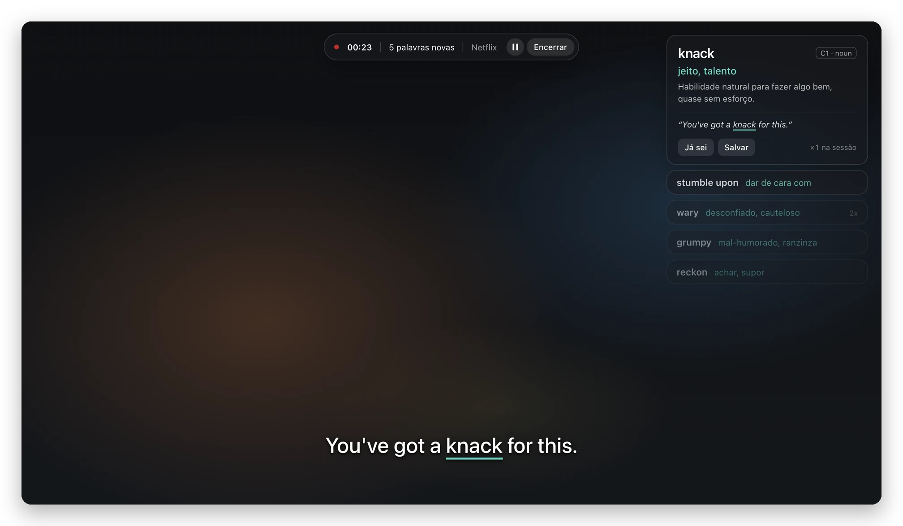
</p>

> As capturas são do app real, com traduções de exemplo e uma cena ilustrativa no lugar do vídeo. O
> quiz, o histórico e o menu da barra vêm da página de preview, que monta os mesmos componentes com os
> dados do mockup.

## Como funciona

1. Você liga as legendas em inglês na Netflix ou no YouTube e inicia uma sessão com ⌘⇧L.
2. A extensão lê cada legenda que aparece e a envia ao app por um WebSocket local.
3. O app escolhe as palavras do seu nível, pede a tradução à IA e mostra um card no canto da tela. A
   palavra também ganha um sublinhado na própria legenda.
4. Ao encerrar com ⌘⇧E, você escolhe as palavras e faz um quiz de 10 questões. As que você errar
   voltam para revisão nos dias seguintes.

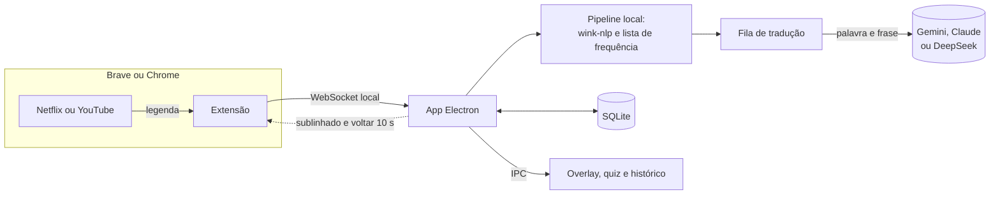

Cada legenda passa por limpeza, tokenização e lematização, detecção de phrasal verbs e expressões, e
um filtro pelo seu nível baseado numa lista de frequência. Tudo isso roda no Mac. Só as palavras
escolhidas vão para a IA, junto com a frase em que apareceram, para que a tradução siga o sentido da
cena. Uma palavra traduzida fica salva e não volta para a IA.

## Recursos

### Cards sobre o vídeo

- O card novo mostra a tradução, uma explicação curta em português e a frase da cena. Os anteriores
  encolhem para um resumo, e passar o mouse abre o card de novo, com outro exemplo.
- A tradução chega em streaming, antes da explicação, e as próximas palavras são traduzidas enquanto
  você lê o card atual.
- Funciona com o vídeo em tela cheia, e a pilha pode ser arrastada para qualquer ponto da tela. Cada
  monitor guarda a própria posição.
- Botões para salvar a palavra ou marcá-la como conhecida, para que não apareça mais.

<table>
  <tr>
    <td width="50%">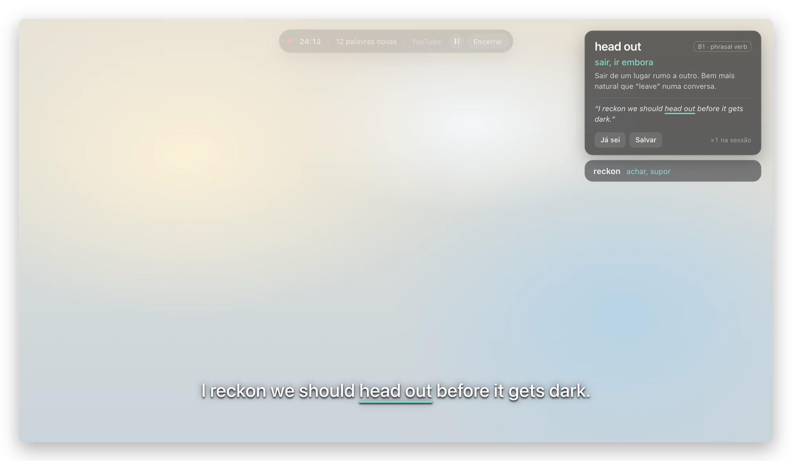</td>
    <td width="50%">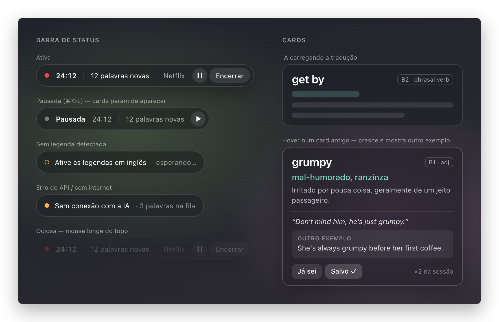</td>
  </tr>
  <tr>
    <td>Numa cena clara. A barra da sessão some quase toda enquanto o mouse está longe do topo.</td>
    <td>Os estados da barra e dos cards: pausa, falta de legenda, erro da IA, tradução a caminho e o card aberto pelo mouse.</td>
  </tr>
</table>

### Busca com ⌘⇧B

Ouviu uma palavra que não virou card? ⌘⇧B abre uma barra por cima do vídeo, mesmo em tela cheia, sem
tirar o navegador da frente. A palavra entra como um card normal, com a frase da legenda em que
apareceu, e vai para o histórico e para o quiz. Uma opção volta o vídeo 10 segundos para você ouvir de
novo.

<p align="center">
  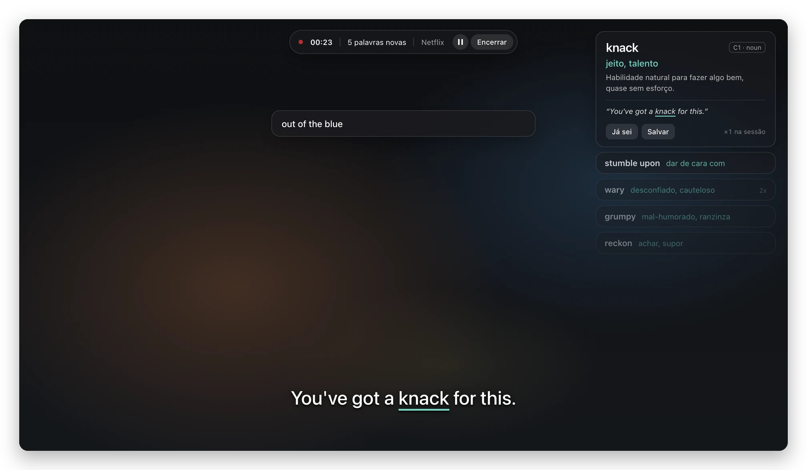
</p>

### Todas as palavras e mais de um card por vez

O nível escolhe as palavras pela frequência, e às vezes deixa passar uma que você não sabia. O modo
"Todas as palavras" ignora o nível. Uma palavra que volta aparece só em resumo, com o contador `2x`,
`3x`, sem chamar a IA de novo, e passar o mouse mostra o resto.

Nas Configurações você também escolhe quanto tempo cada card fica aberto, de 3 a 30 segundos, quantos
ficam abertos ao mesmo tempo, até 3, quantos cards por minuto e quantos resumos ficam na tela.

<table>
  <tr>
    <td width="40%">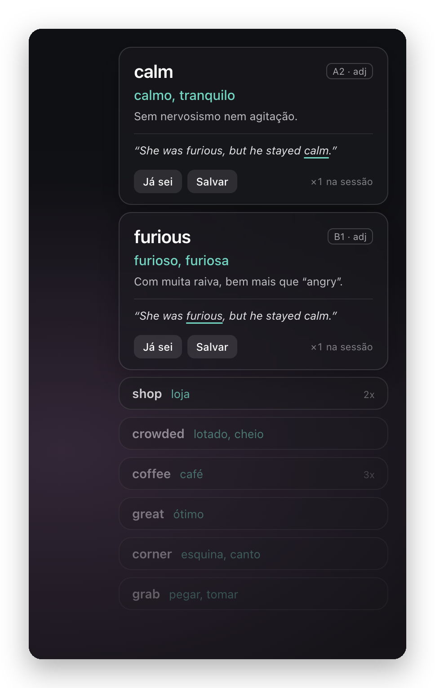</td>
    <td width="60%">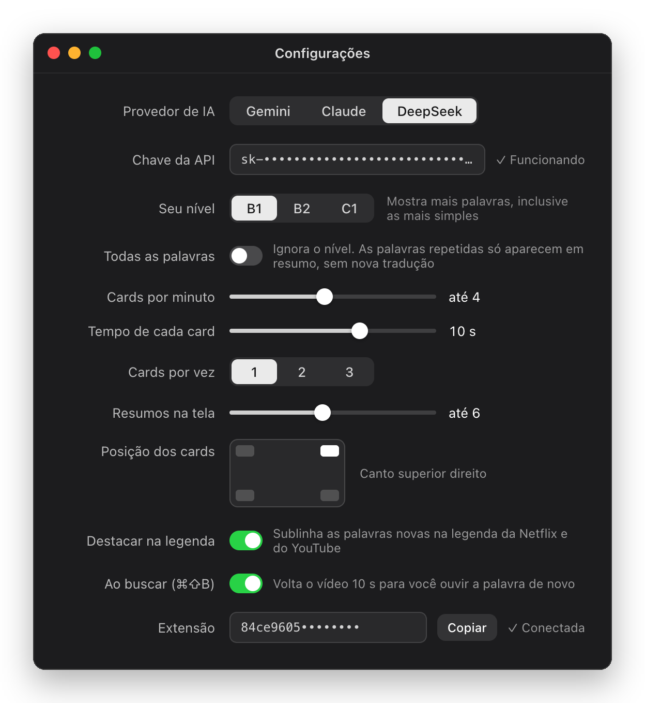</td>
  </tr>
</table>

### Quiz e revisão

Ao encerrar a sessão, você vê o que aprendeu, escolhe as palavras e faz o quiz. São 7 tipos de
questão: múltipla escolha nos dois sentidos, completar a frase, sentido no contexto, associar, verdadeiro
ou falso e digitar a palavra. As teclas 1 a 4 respondem e Enter avança. As palavras entram numa revisão
espaçada com SM-2, e o quiz é montado localmente se faltar a chave ou a internet.

<table>
  <tr>
    <td width="50%">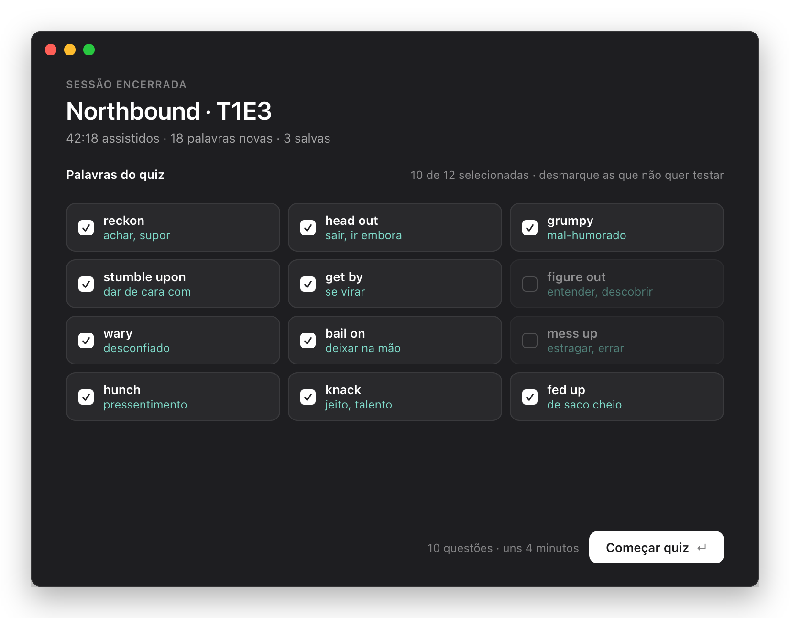</td>
    <td width="50%">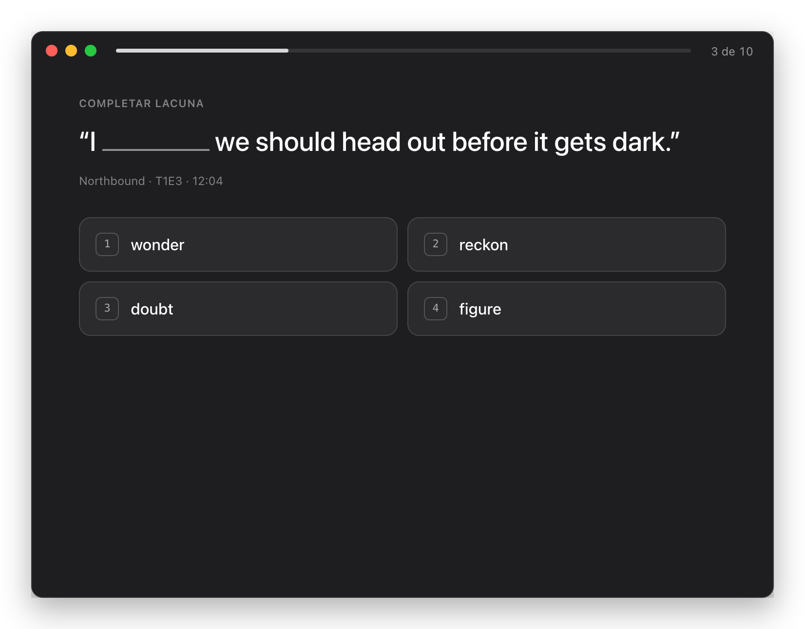</td>
  </tr>
  <tr>
    <td width="50%">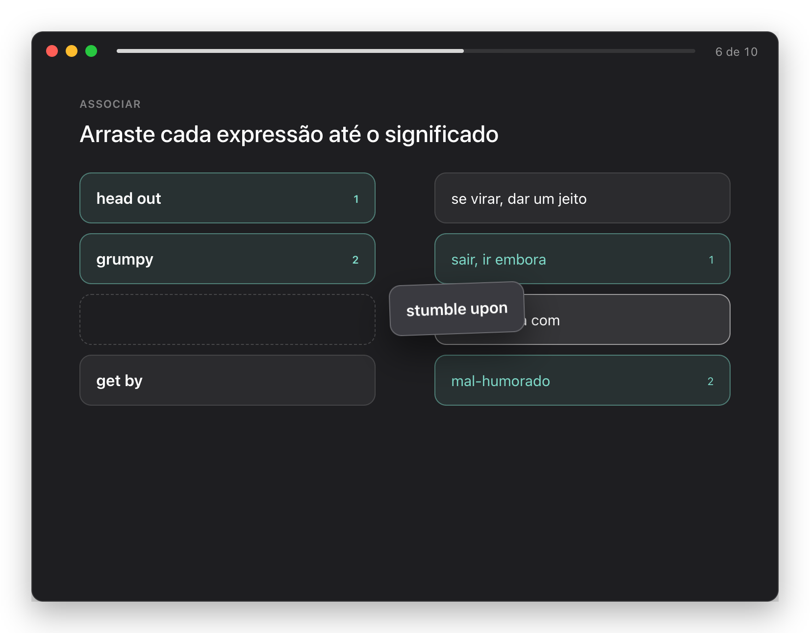</td>
    <td width="50%">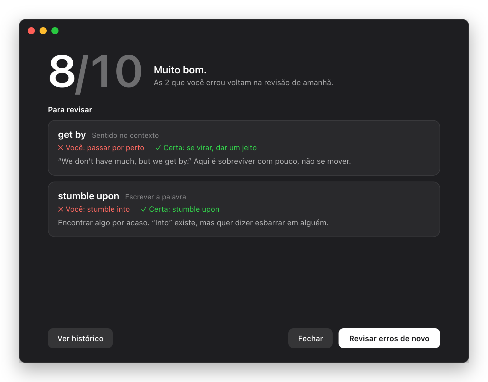</td>
  </tr>
</table>

### Histórico

Todas as sessões e palavras, com quantas vezes cada uma apareceu, os acertos, o nível e a próxima
revisão. Dá para buscar, filtrar e refazer o quiz de uma sessão.

<p align="center">
  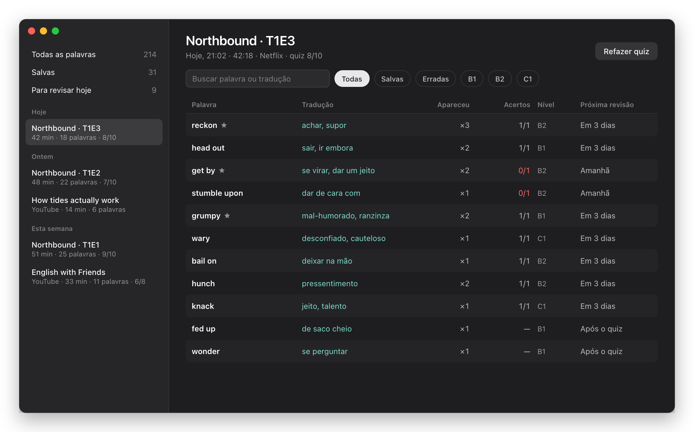
</p>

### Barra de menus e extensão

<table>
  <tr>
    <td width="62%">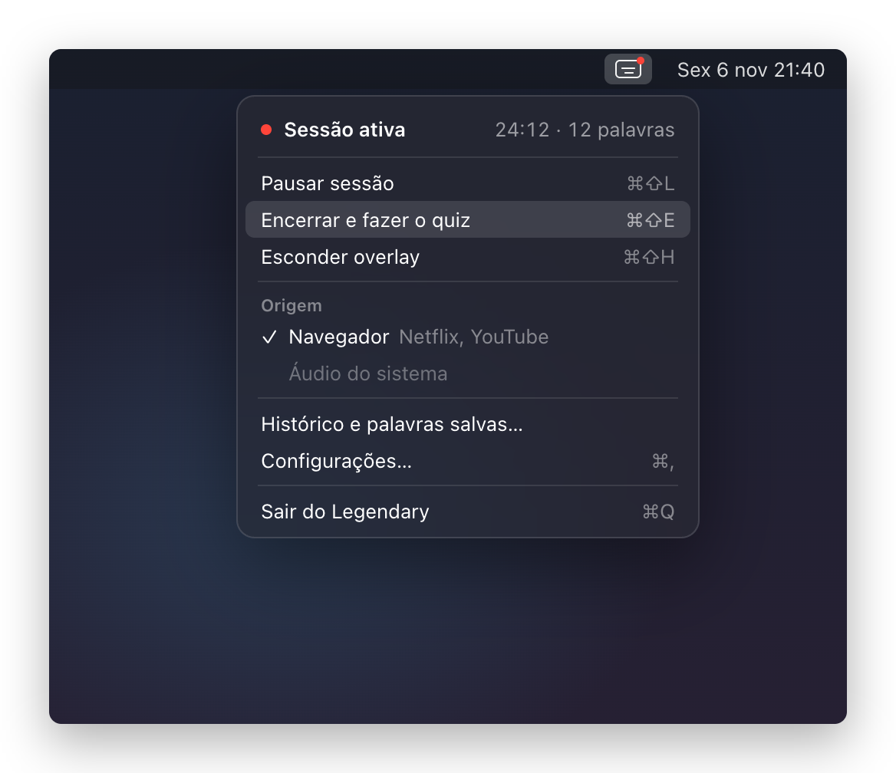</td>
    <td width="38%">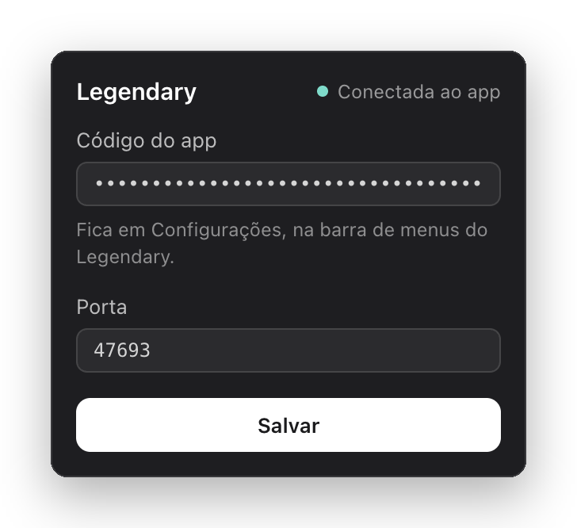</td>
  </tr>
  <tr>
    <td>O menu da barra controla a sessão e abre o histórico e as Configurações.</td>
    <td>O popup da extensão, onde você cola o código que conecta o navegador ao app.</td>
  </tr>
</table>

## Atalhos

| Atalho | O que faz |
| --- | --- |
| ⌘⇧L | Inicia a sessão, ou pausa e retoma |
| ⌘⇧E | Encerra a sessão e abre o quiz |
| ⌘⇧B | Abre a busca de palavra. Também funciona com o foco no player |
| ⌘⇧K | Marca a palavra do card atual como conhecida |
| ⌘⇧H | Esconde ou mostra os cards |

## Tecnologias

| Camada | Tecnologia |
| --- | --- |
| Linguagem | TypeScript 6 em modo `strict`, num monorepo com pnpm 12 |
| Desktop | Electron 45 e electron-vite 6 |
| Interface | React 19, Tailwind CSS 4, Motion 14 e Zustand 5 |
| Banco | SQLite com better-sqlite3 13 e Drizzle ORM 0.45 |
| IA | AI SDK 7 com Gemini (`gemini-2.5-flash`), Claude (Haiku 5.5 traduz e Opus 5.5 monta o quiz) e DeepSeek (`deepseek-v4-flash`) |
| Linguagem natural | wink-nlp 2, local: tokenização, lematização e classes gramaticais |
| Contratos | Zod 4 nas mensagens IPC, no WebSocket e nas respostas da IA |
| Extensão | WXT 0.21, Manifest V3 |
| Comunicação | WebSocket local com `ws` 8 |
| Testes | Vitest 5 e Playwright 1.65 no app Electron, na extensão e na comparação com o mockup |
| Qualidade | ESLint 10, Prettier 3, Lefthook e commitlint |
| Empacotamento | electron-builder 26 |

## Estrutura

```
apps/
  desktop/     App Electron: processo main (serviços, IA, banco e janelas), preload e telas
  extension/   Extensão: lê as legendas, sublinha a palavra e volta o vídeo
packages/
  contracts/   Schemas e tipos compartilhados: IPC, WebSocket, IA e domínio
  core/        Lógica pura: pipeline das legendas, quiz e revisão espaçada
  db/          Schema do banco e migrações
design/        Cópia do mockup e os frames de referência dos testes visuais
docs/          Capturas de tela
```

## Privacidade e segurança

- Sessões, palavras e quizzes ficam num SQLite em `~/Library/Application Support/Legendary`. Não há
  conta nem servidor do Legendary.
- Para a IA vão só as palavras escolhidas e a frase em que apareceram, direto para o provedor que você
  escolheu, com a sua chave.
- A chave da API é cifrada com o `safeStorage` do Electron, que guarda a chave de cifragem no Keychain.
  Ela nunca sai do processo main: as janelas só recebem uma versão mascarada.
- O WebSocket só escuta em `127.0.0.1`, exige o código de pareamento e recusa conexões vindas de sites.
- As janelas rodam com sandbox e isolamento de contexto, sem acesso ao Node e com CSP restrita. Cada
  mensagem IPC é validada.

## Como rodar

Requisitos: macOS 13 ou mais novo, Homebrew, Xcode Command Line Tools, Brave ou Chrome, e uma chave de
API do Gemini, do Claude ou do DeepSeek.

```bash
brew install node@22 pnpm
make setup
make dev
```

O `Makefile` usa o Node 22 do Homebrew mesmo que ele não seja o padrão da máquina. Na primeira
execução, o app pede a chave da API e o seu nível de inglês.

Para instalar a extensão:

1. Rode `make build-ext`, que gera a pasta `apps/extension/.output/chrome-mv3`.
2. Em `brave://extensions` ou `chrome://extensions`, ligue o modo do desenvolvedor, clique em "Carregar
   sem compactação" e escolha essa pasta. Como `.output` começa com ponto, aperte ⌘⇧. no seletor para
   ver as pastas ocultas.
3. Copie o código em Configurações → Extensão e cole no popup da extensão.

Depois de atualizar o código da extensão, recarregue-a na página de extensões.

## Comandos

| Comando | O que faz |
| --- | --- |
| `make dev` | Roda o app com hot reload |
| `make build-ext` | Gera a extensão em `apps/extension/.output/chrome-mv3` |
| `make ci` | Lint, tipos e testes de unidade e integração |
| `make test-e2e` | Testes ponta a ponta no app real, inclusive com a extensão em um Chromium |
| `make test-visual` | Compara cada tela com o frame do mockup, em `design/reference` |
| `make package` | Gera o `.dmg` local, sem assinatura |
| `make help` | Lista todos os alvos |

Os testes ponta a ponta abrem janelas de verdade e registram os atalhos globais enquanto rodam, então é
melhor não usar o computador ao mesmo tempo.

## UI

A referência visual é o mockup do Claude Design, com cópia local em `design/`. Toda mudança de UI
precisa ser conferida contra ele. As telas são componentes sem acesso ao IPC, e a página
`src/renderer/preview` os monta com os dados do mockup para o `make test-visual` comparar.

## Diferenças em relação à especificação

- **Vidro do overlay:** sem `vibrancy` na janela do overlay. Vibrancy vale para a janela inteira e
  embaçaria o vídeo todo, então os cards usam só CSS, sem blur real do que está atrás. O vidro fica
  isolado na classe `.glass`, em `src/renderer/shared/theme.css`.
- **Menu da barra:** é uma janela própria (`windows/menu.ts`), porque um menu nativo não reproduz o
  frame 1d.
- **Áudio do sistema:** ainda não existe (fase 4). A opção aparece desabilitada no menu e o
  `make build-native` só avisa que não há nada para compilar.
- **Versões:** TypeScript 6.0, e não 7, porque o `typescript-eslint` ainda não aceita o 7. As demais
  usam a última versão com mais de 24 h de publicada, exigência do pnpm 12.
- **Lint de importação:** `eslint-plugin-import-x` no lugar do `eslint-plugin-import`, que não aceita
  ESLint 10. A regra continua se chamando `import/no-restricted-paths`.
- **SM-2:** o primeiro acerto agenda a revisão para 3 dias, como no mockup. O SM-2 clássico usa 1 dia.
- **Quiz sem IA:** se a chave faltar ou a chamada falhar, o quiz é montado localmente com as palavras
  da sessão.
- **Fila de tradução:** a especificação pedia lotes de 5 palavras ou 8 segundos, mas os cards saem um
  por vez e cada palavra esperava os 8 segundos inteiros. Agora a palavra de um card vai na hora, e
  as melhores palavras que esperam a vez são traduzidas antes, em paralelo, em até 6 das 10 chamadas
  por minuto.
- **Resposta da IA:** a tradução vem em streaming, para aparecer antes da explicação, e o raciocínio
  dos modelos fica desligado nessa etapa. No Claude, a tradução usa o Haiku 5.5 e o quiz, o Opus 5.5.
- **Tempo dos cards:** a especificação previa de 10 a 15 segundos e o mockup desenha 3 cards. O card
  encolhe depois do tempo escolhido e continua como resumo por até 3 minutos.
- **Cards por minuto:** a especificação ia de 1 a 4. Agora vai até 15, nos passos 1, 2, 4, 6, 8, 10 e 15.
  O "até 2" continua em 33% da faixa, como no frame 1e.
- **Tempo de cada card e cards por vez:** não estão na especificação nem no mockup. O próximo card só
  entra quando há um lugar livre e o limite por minuto permite. Cada card ocupa um lugar pelo tempo
  escolhido, contado a partir da explicação, e podem ficar até 3 abertos. Com um card por vez, 15 cards
  por minuto pedem um tempo de até 4 segundos, e 10 cards, de até 6.
- **Próximo card:** entre as palavras que esperam a vez, vai primeiro uma que já tenha tradução.
- **Resumos na tela:** de 1 a 12, com padrão 6. A linha não tem frame no mockup. Um resumo dura até
  3 minutos, então só dá para ver 12 deles a partir de 4 cards por minuto.
- **Todas as palavras:** não está na especificação nem no mockup. A opção, desligada por padrão, ignora
  o nível e a lista de frequência. Só ficam de fora as palavras gramaticais básicas e os nomes próprios.
  A palavra que volta, inclusive de outra sessão, aparece só em resumo com o contador, sem chamar a IA.
  A que espera mais de 10 segundos pelo card também vira resumo, em vez de se perder.
- **Busca de palavra:** não está na especificação nem no mockup. O atalho ⌘⇧B abre uma barra, e a
  extensão também o escuta dentro do player. Sem sessão, a barra só explica que é preciso iniciar uma.
  A palavra digitada vira um card na hora, fora do limite por minuto, e entra no histórico e no quiz.
  Ela usa a frase de uma legenda recente que tenha a palavra e, se não houver, um exemplo da IA. Depois
  disso, ela é contada toda vez que aparece, sem voltar para a IA. A opção "Ao buscar", nas
  Configurações, volta o vídeo 10 segundos e vem desligada por padrão. Na Netflix isso usa a API
  interna do player, porque mudar o `currentTime` do vídeo gera erro, e pode parar de funcionar se ela
  mudar.
- **Posição dos cards:** além dos 4 cantos, a pilha pode ser arrastada para qualquer ponto da tela, e
  cada monitor guarda a própria posição. Para isso a janela do overlay cobre a tela inteira, inclusive
  a faixa da barra de menus. Escolher um canto nas Configurações apaga as posições arrastadas.

## Dados de terceiros

A lista de frequência deriva do projeto FrequencyWords, sob CC BY-SA 4.0. Veja
`apps/desktop/resources/NOTICE.md`.
